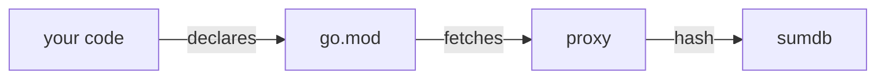

# Securing Go for <Marker>Production</Marker>

go run talk.go --topic="the compiler won't save you"

---
layout: intro
introImage: /theme/me.png
github: davideimola
bluesky: "@davideimola.dev"
linkedin: davideimola
---

<WhoAmI />

---
layout: section
label: "01 · why now"
transition: fade
---

# Why now

Security is becoming more and more important.

---
layout: fact
---

# 31%

of breaches start with vulnerability exploitation

<div class="mt-6 text-base opacity-60">Verizon DBIR 2026</div>

<!-- Source: Verizon DBIR 2026 news release (2026-05-19): "Nearly a third (31%) of all breaches start with vulnerability exploitation". For the first time in 19 years it has passed stolen credentials as the number one entry point.
     https://www.verizon.com/about/news/breach-industry-wide-dbir-finds
     Bridge: a third of breaches start with a bug somebody shipped. In code we wrote, or code we pulled in. That is the whole talk.
     Alternative: Mandiant M-Trends 2026, mean time to exploit "an estimated -7 days" (exploited before the patch exists). -->

---
layout: split-code
---

###### intro / teaser

# We shipped <Marker>this</Marker>

Thirteen months in production.

Code review approved it. Tests were green.

Hold that thought.

<!-- Go port of the real bug (the original was a GraphQL directive). Don't explain it here: the audience gets 10 seconds to spot it, then we move on. It comes back in section 02. -->

::right::

```go
func canManageOrg(u User, orgID string) bool {
	if u.IsSuperAdmin {
		return true
	}
	if orgID == "" {
		return true // org not resolved
	}
	return u.OrgID == orgID // membership, not role
}
```

---
layout: statement
---

# The compiler won't save you. Your toolchain might.

---
layout: default
---

# What we'll cover

<div class="space-y-5 mt-8">

<v-click>
<div class="flex items-baseline gap-4">
  <span class="text-2xl font-mono opacity-40">01</span>
  <h3 class="text-2xl m-0">The code you write</h3>
</div>
</v-click>

<v-click>
<div class="flex items-baseline gap-4">
  <span class="text-2xl font-mono opacity-40">02</span>
  <h3 class="text-2xl m-0">The code you use</h3>
</div>
</v-click>

<v-click>
<div class="flex items-baseline gap-4">
  <span class="text-2xl font-mono opacity-40">03</span>
  <h3 class="text-2xl m-0">Make it routine</h3>
</div>
</v-click>

</div>

---
layout: section
label: "02 · the code you write"
transition: fade
---

# The code you write

---
layout: statement
---

# Go is safe by default.

<v-click>

# Your <Marker>application</Marker> isn't.

</v-click>

<!-- ~30s. Pause between the two lines. -->

---
layout: two-cols-header
---

# What the compiler can't <Marker>know</Marker>

::left::

###### go build checks

- Types
- Memory safety
- Bounds and nil, at runtime
- Data races, with `-race`

::right::

###### nobody checks

<v-clicks>

- Who may read this resource
- Where this request is going
- How much this request costs

</v-clicks>

<!-- ~1min. Left side: what Go gives you for free, be generous, it's a Go room.
     Right side, one click each: these three questions are the next three slides
     (who → authorization, where → trust boundaries, how much → resource exhaustion). -->

---
layout: split-code
---

###### trust boundaries

# The client chose this <Marker>URL</Marker>

Every ID, URL and header in a request is a claim, not a fact.

`net/http` fetches whatever you hand it: internal IPs, cloud metadata, redirects included.

::right::

```go {all|2|3}
func preview(w http.ResponseWriter, r *http.Request) {
	target := r.URL.Query().Get("url")
	resp, err := http.Get(target) // 169.254.169.254?
	if err != nil {
		http.Error(w, "bad gateway", http.StatusBadGateway)
		return
	}
	defer resp.Body.Close()
	io.Copy(w, resp.Body)
}
```

<!-- ~1min15. SSRF as ONE example of client-controlled data, not a tutorial.
     The fix in one breath: allow-list the destinations, resolve and reject private/link-local IPs, control redirects with CheckRedirect.
     The fix pattern lives in the template repo (section 04). -->

---
layout: split-code
---

###### resource exhaustion

# Valid request. Unbounded <Marker>cost</Marker>.

No malformed input. No exploit.

Just a request bigger than you planned for.

<v-click>

We'll meet this again, inside the standard library.

</v-click>

::right::

```go {1-2|4-6}
// as big as the client wants
body, err := io.ReadAll(r.Body)

// 1 MB, then 413
r.Body = http.MaxBytesReader(w, r.Body, 1<<20)
body, err = io.ReadAll(r.Body)
```

<!-- ~1min15. Same family: http.Server without ReadHeaderTimeout, unbounded goroutines per request, regex on user input.
     The v-click line plants the seed for section 03: archive/zip, CVE-2025-61728, super-linear file name indexing → CPU DoS. -->

---
layout: fact
---

# 100%

of the applications OWASP tested had some form of broken access control

<div class="mt-6 text-base opacity-60">OWASP Top 10:2025 · A01</div>

<!-- Exact wording on the A01 page: "100% of the applications tested were found to have some form of broken access control".
     Number one category, 1,839,701 occurrences, 40 CWEs.
     https://top10.owasp.org/2025/A01_2025-Broken_Access_Control
     (Don't quote the incidence %: 3.73% on the intro page vs 3.74% on A01.) -->

---
layout: statement
---

# Including <Marker>ours</Marker>.

<!-- Deadpan. Then click back to the teaser code. -->

---
layout: code-hero
---

###### the bug · 13 months in production

```go {all|5-7|8}
func canManageOrg(u User, orgID string) bool {
	if u.IsSuperAdmin {
		return true
	}
	if orgID == "" {
		return true // org not resolved
	}
	return u.OrgID == orgID // membership, not role
}
```

<!-- ~1min30. Two logic errors, one click each.
     1) Fail-open: if the target org can't be resolved from the request, access granted. To anyone.
     2) Role never checked: membership is enough. A viewer can use admin-only features.
     Never exploited. About 13.5 months in production.
     Original was not Go: don't make it a point. "This bug compiles in every language." -->

---
layout: default
---

# Every test asked who gets <Marker>in</Marker>

| Case | Tested |
|---|:---:|
| Super admin manages any org | ✓ |
| Org admin manages their org | ✓ |
| Viewer manages their org | ✗ |
| Admin manages another org | ✗ |
| Org can't be resolved | ✗ |

<v-click>

**None asked who stays out.**

</v-click>

<!-- ~1min. THE meta-takeaway. Review approved it, tests were green, because every test was a positive case. -->

---
layout: statement
---

# We knew something was wrong. Not <Marker>where</Marker>.

<!-- ~20s. ONE line about the trigger: an external security report said access control was broken somewhere. It didn't say where.
     Don't dwell on "pen test": the point is what we did next. -->

---
layout: default
---

# The <Marker>loop</Marker>

<Ladder compact>
  <LadderRung v-click :n="1" title="Analyze">give the AI the context, not the whole codebase</LadderRung>
  <LadderRung v-click :n="2" title="Find">it points to where it could break</LadderRung>
  <LadderRung v-click :n="3" title="Test">it writes the test that would prove it</LadderRung>
  <LadderRung v-click :n="4" title="Verify">a human reads the red test</LadderRung>
  <LadderRung v-click :n="5" title="Fix">test first, then the code</LadderRung>
</Ladder>

<!-- ~45s. This loop is the spine of the talk: the next slides walk it once on this bug. -->

---
layout: default
---

<Rungs :active="2" :total="5" label="analyze · find" />

# Ask a narrow <Marker>question</Marker> <Badge>reconstructed</Badge>

<Chat>
  <ChatBubble user>Review our authentication and authorization layer. For each check, list the logic errors that could grant access to the wrong user. Assume the caller is hostile.</ChatBubble>
  <ChatBubble>canManageOrg returns true when orgID can't be resolved. It also checks membership, never the admin role.</ChatBubble>
</Chat>

<!-- ~1min. The original prompts are gone: say it, that's why the badge is there.
     What matters is the shape: targeted on the auth layer, asking for logic errors, hostile caller. Not "find bugs in my repo". -->

---
layout: split-code
---

<Rungs :active="3" :total="5" label="test" />

# Make it <Marker>red</Marker>

We asked for tests on who must be denied.

Generated by the AI. Read line by line by us.

::right::

```go {all|5-7}
func TestCanManageOrgDenies(t *testing.T) {
	viewer := User{OrgID: "acme"}
	admin := User{IsOrgAdmin: true, OrgID: "acme"}

	deny(t, viewer, "acme")  // member, not admin
	deny(t, admin, "globex") // admin of another org
	deny(t, admin, "")       // org not resolved
}
```

<!-- ~1min. `deny` is a 4-line helper (t.Helper + t.Errorf if access is granted), not shown. -->

---
layout: terminal
title: "$ go test -run TestCanManageOrgDenies"
---

```sh
--- FAIL: TestCanManageOrgDenies (0.00s)
    authz_test.go:16: granted: {IsSuperAdmin:false IsOrgAdmin:false OrgID:acme} on "acme"
    authz_test.go:18: granted: {IsSuperAdmin:false IsOrgAdmin:true OrgID:acme} on ""
FAIL
```

Two of three. That's not an opinion anymore.

<!-- ~30s. Real output from the Go port. Hypothesis → evidence. -->

---
layout: split-code
---

<Rungs :active="5" :total="5" label="verify · fix" />

# Deny by <Marker>default</Marker>

Two explicit ways in. Everything else stays out, including the request we can't place.

Red to green, released right away.

::right::

```go {all|2-4|8}
func canManageOrg(u User, orgID string) bool {
	if orgID == "" {
		return false
	}
	if u.IsSuperAdmin {
		return true
	}
	return u.IsOrgAdmin && u.OrgID == orgID
}
```

<!-- ~1min. Note the order: the deny check comes BEFORE the super admin shortcut.
     The follow-up PR added negative tests, multi-role scenarios and edge cases to every authorization check, not only this one. -->

---
layout: statement
---

# A bug can survive 13 months.

<v-click>

# Not because the code is complex. Because nobody tested the right <Marker>assumption</Marker>.

</v-click>

---
layout: code-hero
---

###### make it stay fixed

```go {all|2|6-7|9-11}
func FuzzCanManageOrg(f *testing.F) {
	f.Add(false, true, "acme", "acme") // the happy path
	f.Fuzz(func(t *testing.T,
		super, admin bool, userOrg, org string) {

		u := User{super, admin, userOrg}
		allowed := org != "" &&
			(super || (admin && userOrg == org))

		if canManageOrg(u, org) && !allowed {
			t.Fatalf("granted: %+v on %q", u, org)
		}
	})
}
```

<!-- ~1min15. The table test checks the cases we thought of. The fuzzer checks the ones we didn't.
     Click 1: the seed is the ONLY case the old tests had, the happy path. The fuzzer starts from there.
     Click 2: the property. Deny by default, written once.
     Click 3: the assertion. -->

---
layout: terminal
title: "$ go test -fuzz=FuzzCanManageOrg"
---

```sh
fuzz: elapsed: 0s, gathering baseline coverage: 1/1 completed, now fuzzing with 15 workers
fuzz: minimizing 70-byte failing input file
--- FAIL: FuzzCanManageOrg (0.03s)
    authz_test.go:31: granted: {IsSuperAdmin:false IsOrgAdmin:false OrgID:acme} on ""

    Failing input written to testdata/fuzz/FuzzCanManageOrg/a8949c542c89c1fa
    To re-run:
    go test -run=FuzzCanManageOrg/a8949c542c89c1fa
FAIL
```

<!-- Real output against the VULNERABLE version (go1.26, M-series Mac). Optional live run, low risk.
     If you fix only the fail-open, the fuzzer finds the viewer case in the same ~0.05s.
     Against the fixed version: 11.6M execs in 10s, clean.
     The failing input lands in testdata/: commit it and it becomes a regression test forever. -->

---
layout: fact
---

# 0.03s

for the fuzzer. Thirteen months for us.

---
layout: statement
---

# It also found a real bug in code nobody calls.

<v-click>

# True. But <Marker>unreachable</Marker>.

</v-click>

<!-- ~45s. After this bug we ran the loop on purpose, with no report to start from: it found things nobody had reported (missing security headers, broken logic).
     It also flagged a real issue in a deprecated feature we would never call again. A true finding that doesn't matter.
     Bridge to section 03: govulncheck draws exactly this line, using the call graph. -->

---
layout: statement
---

# Tools give you signals.

<v-click>

# AI gives you hypotheses.

</v-click>

<v-click>

# Tests give you <Marker>evidence</Marker>.

</v-click>

<!-- The guiding line of the talk. It comes back in the closing. Pause after "evidence". -->

---
layout: section
label: "03 · the code you use"
transition: fade
---

# The code you use

---
layout: default
---

# When npm was npm

[Narrative, 4-6 lines. Tell the Axios story sharply.
- WHEN: date the malicious version went live (March 2026?)
- WHAT: maintainer account compromised → malicious release auto-shipped
- HOW BIG: weekly downloads (cite exact number, e.g. "~50M weekly")
- TIME WINDOW: hours / days the bad version was live
- PAYLOAD: brief — data exfiltration? backdoor? what kind?
- CLEANUP: why it was hard (caching, auto-install, lockfiles)]

<!-- FILLER — gather exact numbers + payload details before the talk.
     Open question in TALK.md. Without numbers this slide is just rhetoric. -->

---
layout: default
---

# "But this is npm." Is it?

[Bridge line, 1-2 lines. e.g. "Go has better defaults. It's not bulletproof."]

- [Go-side case 1 — e.g. `tj-actions/changed-files` (March 2025), secrets leaked from Go CI pipelines via a compromised GitHub Action]
- [Go-side case 2 — research a real recent module compromise / typosquatting incident]

<!-- FILLER — research 1-2 real Go-side supply chain incidents before the talk.
     If only 1 solid case exists, use 1 bullet (don't pad).
     Open question in TALK.md. Goal: stop the audience thinking "this is a JS problem". -->

<!-- delivery: ~30-45s. Not a deep dive — acknowledgement.
     "Go has the infrastructure. But the infrastructure is only as good as your habits." -->

---
layout: statement
---

# Go gives you the answer: sumdb.

<!-- delivery: short beat, pivot. The npm story sets up the urgency.
     This statement says "we have a defense — and you're probably not using it consciously." -->

---
layout: default
---

# Go modules — the trust chain



<!-- delivery: ~45s. Walk left-to-right. The arrows tell the story:
     code declares deps, proxy fetches them, sumdb provides the hash.
     Then click to the next slide for the verify command.

     === NOTES: HOW IS THIS DIFFERENT FROM npm? ===
     Important nuance: the Axios incident was a NEW minor release (e.g. 1.15.0 → 1.15.1)
     pushed by the compromised maintainer account, NOT a rewrite of an existing version.
     sumdb protects you from rewrites of an existing version's hash; it does NOT
     protect you from a brand-new malicious release. The protections that matter
     for the Axios-class threat are different:

     1) Exact versions in go.mod (no caret/tilde ranges).
        npm with `^1.15.0` pulls 1.15.1 automatically on the next `npm install`.
        Go's `go.mod` pins an exact version. The new malicious 1.15.1 is NOT
        downloaded until you explicitly run `go get -u` or update `go.mod`.

     2) No auto-update without intent.
        Go updates are deliberate: `go get pkg@latest`, `go mod tidy`, or a
        manual edit. npm's defaults move silently inside the version range.

     3) No script execution at install.
        This is where Axios actually got people: the postinstall script ran
        the moment `npm install` resolved the new version. Go's `go get` /
        `go build` don't execute arbitrary code — a module runs only when
        you explicitly import and call it.

     4) (still true, different threat) sumdb is a transparent, immutable log.
        Protects against rewrites/MITM on existing versions. Doesn't help
        for new malicious releases — but eliminates a different attack class
        entirely. npm has no equivalent.

     PUNCHY LINE if you want it on stage:
     "If a maintainer's account got compromised tomorrow and they pushed v1.15.1
     with a malicious payload: in Go, your `go.mod` still pins v1.15.0 — the new
     version isn't pulled until you explicitly run `go get -u`. And even then,
     the code doesn't execute until you actually use the affected API.
     In npm, with `^1.15.0` and a postinstall script, you're owned by the next
     `npm install`."
-->

---
layout: terminal
title: "$ go mod verify"
---

```sh
all modules verified
```

`go.sum` records the hashes. **`go mod verify`** confirms they still match on disk.

<!-- delivery: ~30s. The point: the verification is one command,
     it should run in your release pipeline. Pair it with `govulncheck`. -->


---
layout: default
---

# What about CVEs in our dependencies?

Hashes match. But are any of them known to have CVEs?

Go has an official scanner for that. Let's run it.

---
layout: terminal
title: "$ govulncheck ./..."
---

```sh
$ govulncheck ./...
Scanning... 234 packages, 12 modules.

Vulnerability: GO-2025-61728
  Standard library
    Found in:    archive/zip@go1.21.5
    Fixed in:    archive/zip@go1.22.0
    Example trace:
      main.go:42  app.HandleUpload → archive/zip.NewReader

Your code is affected by 1 vulnerability.
```

<!-- LIVE DEMO start. Plan B: GOVULNDB local mirror + asciinema + this slide as static fallback.
     Cut from real output: long URL, prose CVE description (covered by next slide),
     the boilerplate scan line. Kept: stdlib (dramatic), versions (actionable),
     trace (the call-graph differentiator — that's the whole point). -->


---
layout: default
---

# It scans your call graph, not your go.sum

[Narrative, 3-5 lines. The KEY differentiator:
- govulncheck walks the call graph from your `main`
- Out of N CVEs in your dependencies, only the ones you *reach* are reported
- Less noise → fixes you'll actually do
- Example: "7 CVEs in `go.sum`, 2 in our call graph. The other 5 were quiet."]

<!-- delivery: this is THE slide that sells govulncheck over alternatives.
     Spend 90s here. The live demo on the previous slide is the wow,
     this is the explanation that makes it stick. -->

---
layout: default
---

# CVE-2025-61728 — zip DoS

A malformed zip file → unbounded CPU/memory consumption.

Any service that decompresses user-uploaded zips dies.

You don't need to know how. **`govulncheck` knows for you.**

<!-- 30 seconds max. Concept slide only — NO live exploit PoC.
     The "you don't need to know how" line reinforces the thesis:
     the toolchain does the work, you don't need to be a security expert. -->

---
layout: terminal
title: "$ go get -u && govulncheck ./..."
---

```sh
$ go get -u
go: upgraded archive/zip to v1.22.0

$ govulncheck ./...
Scanning your code and 234 packages across 12 dependent modules
for known vulnerabilities...

No vulnerabilities found.
```

<!-- delivery: short. The fix is one command. Keep it punchy.
     "That's it. We're back to clean. On every commit, this gets re-run." -->

---
layout: split-code
---

###### sez 2 / in CI

# Bring it to your pipeline

You install `govulncheck` once. It runs on every PR and push.

The build fails on new vulnerabilities.

::right::

```yaml
# .github/workflows/security.yml
name: Security
on: [pull_request, push]
jobs:
  govulncheck:
    runs-on: ubuntu-latest
    steps:
      - uses: actions/checkout@v4
      - uses: actions/setup-go@v5
        with: { go-version: 'stable' }
      - run: |
          go install \
            golang.org/x/vuln/cmd/govulncheck@latest
          govulncheck ./...
```

---
layout: statement
---

# You fixed the known. What about the unknown?

<!-- transition to sez 3. "Known" = govulncheck (CVEs in DB).
     "Unknown" = SBOM (what's actually in your build), SLSA (what you shipped),
     AI (hypothesis-driven assessment). Pause briefly, then click to next section. -->

---
layout: section
label: "04 · make it routine"
transition: fade
---

# Make it routine

---
layout: default
---

# Monday morning

<v-clicks>

- Add `govulncheck` to your CI — one PR, one workflow file
- Write one fuzz test on your most critical auth path
- Add `go mod verify` to your release pipeline

</v-clicks>

<div class="mt-12 opacity-60">
  More on the talk repo: <code>gosec</code>, dependency hygiene, fuzz patterns.
</div>

<!-- delivery: ~2min. Read each item, half a beat between. The point isn't
     to teach — they already saw it — it's to make it concrete and small. -->

---
layout: default
---

# Beyond the toolchain

- **SBOM** — know what's actually in your build (`cyclonedx-gomod`, `syft`)
- **SLSA** — prove what you shipped is what you built
- Both deserve their own talk. **Golab has them. Check the schedule.**

<!-- delivery: ~90s. Don't teach SBOM/SLSA. Acknowledge they exist,
     point to other talks. The honesty buys you trust. -->

---
layout: split-code
---

###### sez 3 / take this

# Ship Monday

I packaged everything we covered.

`govulncheck`, fuzz tests, SBOM generation, SLSA provenance.

One composite GitHub Action. One line in your workflow.

::right::

```yaml
# .github/workflows/security.yml
- uses: davideimola/<action-name>@v1
  with:
    fuzz-time: 30s
```

<!-- TBD: real action repo + name. See open question in TALK.md.
     QR/link to repo will be in the final cover slide. -->

---
layout: default
---

# AI is the next tool

- Use AI for **vulnerability assessment**, not just code writing or review
- Validate every suggestion with a test

<div class="mt-10">

> Attackers are using AI today.
>
> Defenders are still arguing about it.
>
> **Don't be on the wrong side.**

</div>

<!-- delivery: ~90s. The bullets are the practical advice;
     the blockquote is the closing punch of this slide. Pause after
     "Don't be on the wrong side." Let it sit. -->

---
layout: statement
---

# Don't aim for perfect. Aim for paranoid and fix fast.

<!-- delivery: this is THE closing line. After this slide, the cover
     "Thank you" appears. Pause. Audience claps. Walk off. -->

---
layout: end
qr: https://links.davideimola.dev
---

# Thank you

exit 0
