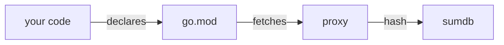

# Talk title with one <Marker>word</Marker>

A short subtitle line, one sentence.

---
layout: intro
introImage: /theme/me.png
github: davideimola
linkedin: davideimola
---

<WhoAmI />

---
layout: section
label: "01 · layouts"
---

# Layouts

One slide per layout. The label becomes the tape and the footer section name on every slide that follows.

---
layout: default
---

# Content slide

The section tape comes from the last `section` slide. Body text is at least 24px.

- First point with `inline code` in it
- Second point with **bold text**
- Third point with a [link](https://davideimola.dev)

> Quotes get a small ink square, never a side bar.

---
layout: default
tape: "custom tape"
---

# Tape overrides

Set `tape: "..."` on a slide to override the inherited section, or `tape: false` to hide it.

The tilt alternates from slide to slide: never two tapes tilted the same way in a row.

---
layout: two-cols
---

# Two columns

Compare two ideas, or pair text with code.

- Left point one
- Left point two

::right::

```go
func NewService(repo Repository) *Service {
	return &Service{repo: repo}
}
```

---
layout: two-cols-header
---

# Title across both columns

::left::

###### before

```go
n := rand.Int63()
token := fmt.Sprintf("%d", n)
```

::right::

###### after

```go
b := make([]byte, 32)
_, _ = rand.Read(b)
token := hex.EncodeToString(b)
```

---
layout: split-code
---

###### concept

# Treat the model like <Marker>untrusted</Marker> input

LLM output is user input with extra steps. Timeout every call, wrap every error.

::right::

```go {all|8-10}
func (a *Agent) Review(
	ctx context.Context, diff string,
) ([]Finding, error) {
	ctx, cancel := withTimeout(ctx)
	defer cancel()

	out, err := a.llm.Complete(ctx, a.prompt(diff))
	if err != nil {
		return nil, fmt.Errorf("review: %w", err)
	}
	// validate before acting on anything
	return parseFindings(out)
}
```

---
layout: code-hero
---

###### spot the bug

```go {all|6}
func getReport(w http.ResponseWriter, r *http.Request) {
	user := session.From(r)
	report := db.FindReport(chi.URLParam(r, "id"))

	canAccess := user.Role == "admin" ||
		user.Prefs.SharedReports // the user decides?

	if !canAccess {
		http.Error(w, "forbidden", http.StatusForbidden)
		return
	}
	json.NewEncoder(w).Encode(report)
}
```

---
layout: terminal
title: "$ go test -fuzz=FuzzIsTenantAdmin"
---

```sh
fuzz: elapsed: 0s, gathering baseline coverage: 2/2 completed
fuzz: elapsed: 1s, execs: 8421 (8421/sec), new interesting: 12

--- FAIL: FuzzIsTenantAdmin (1.04s)
    auth_test.go:8: non-admin "alice" passed admin check on "acme"
FAIL
```

Text after the block sits inside the window, under the output.

---
layout: statement
---

# The compiler won't save you. Your <Marker>toolchain</Marker> might.

---
layout: statement
---

# Setup line.

<v-click>

# Payoff line, revealed on click.

</v-click>

---
layout: fact
---

# 17+

talks and conferences

---
layout: quote
---

# "What you learn, you must share."

davideimola.dev/about

---
layout: center
---

# Centered slide

Horizontally and vertically centered content.

---
layout: image-right
image: /theme/me.png
grayscale: true
---

# Image right

Portraits in black and white with `grayscale: true`. Screenshots stay in colour.

- Images are never rotated
- A tape may sit on a photo's edge

---
layout: image-left
image: /theme/me.png
grayscale: true
---

# Image left

Same layout, mirrored.

- Point one
- Point two

---
layout: section
label: "02 · components"
---

# Components

Restyled for paper: ink, hairlines, red only for the knot and the marker.

---
layout: default
---

# Tape and marker

<div class="flex gap-4 mb-8">
  <Tape :n="0">writing</Tape>
  <Tape :n="1">built by me</Tape>
  <Tape :n="2">talks</Tape>
</div>

`<Tape :n="0">` picks the tilt step (-1deg, 1deg, -0.5deg). One tape per block.

`<Marker>word</Marker>` draws the rough red stroke under <Marker>one</Marker> word. Use it once per slide.

---
layout: default
---

# Typography

- **bold**, *italic*, ~~strikethrough~~, <u>underline</u>
- <mark>mark</mark> is a quiet linen band, not the marker
- `inline code` and <kbd>Space</kbd> <kbd>→</kbd> keys

###### h6 is a mono kicker

## H2 heading

### H3 heading

---
layout: default
---

# Callouts: note and tip

<Callout type="note">Neutral context or background. White block, 2px ink border.</Callout>

<Callout type="tip">A best practice or recommended approach. Same block on linen.</Callout>

<Callout type="note" label="spoken"><code>label</code> replaces the type on the tape.</Callout>

---
layout: default
---

# Callouts: warning and danger

<Callout type="warning">This might have side effects. Heavier 3px border.</Callout>

<Callout type="danger">Breaking change, act now. Inverted: ink block, paper tape.</Callout>

---
layout: default
---

# Badges <Badge type="accent">v1.23</Badge>

- Go <Badge>default</Badge> plain label
- Feature X <Badge type="warning">beta</Badge> not production ready
- Migration <Badge type="success">done</Badge> completed last sprint

---
layout: default
---

# Chat mockup

<Chat>
  <ChatBubble user>Is my app secure?</ChatBubble>
  <ChatBubble>It looks quite secure to me.</ChatBubble>
</Chat>

---
layout: default
---

<Rungs :active="2" label="real case" />

# Step indicator

Keeps the audience oriented inside a multi-step section. Inline: step <RungBadge :n="1" /> works today.

---
layout: default
---

# Ladder

<Ladder>
  <LadderRung v-click :n="1" title="First step">what this step gives you</LadderRung>
  <LadderRung v-click :n="2" title="Second step">what this step gives you</LadderRung>
  <LadderRung v-click :n="3" title="Third step">what this step gives you</LadderRung>
</Ladder>

---
layout: default
---

# Stat grid

<StatGrid class="mt-6">
  <Stat v-click value="17+" source="Source A · 2026">talks and conferences</Stat>
  <Stat v-click value="42" source="Source B · 2026">the answer to everything</Stat>
  <Stat v-click value="9k+" source="Source C · 2024">lines of YAML written</Stat>
</StatGrid>

---
layout: default
---

# Ledger

<Ledger class="mt-6">
  <LedgerRow v-click value="17+" source="source a · 2026" :n="0">talks and conferences,<br>one row per number</LedgerRow>
  <LedgerRow v-click value="42" source="source b · 2026" :n="1">the answer to everything,<br>the meanings line up in one column</LedgerRow>
</Ledger>

---
layout: default
---

# Timeline

<Timeline class="mt-6" :from="0" :to="180" :ticks="[[0, '00:00'], [60, '01:00'], [120, '02:00'], [180, '03:00']]">
  <TimelineEvent v-click :at="20" time="00:20" title="first event" mark>the one that matters</TimelineEvent>
  <TimelineEvent v-click :at="75" time="01:15" title="second event">a plain dot</TimelineEvent>
  <TimelineEvent v-click :at="170" time="02:50" title="last event" align="end">label ends here</TimelineEvent>
  <template #spans>
    <TimelineSpan v-click :from="20" :to="170">a span under the axis</TimelineSpan>
  </template>
</Timeline>

---
layout: default
---

# Table

| Column A  | Column B    | Column C |
|-----------|:-----------:|---------:|
| Row one   | centered    | right    |
| Row two   | value       | `42`     |
| Row three | other value | `1337`   |

---
layout: default
---

# Diagram



---
layout: default
---

# Browser frame: screenshot

<div class="h-[440px] flex">
<BrowserFrame url="davideimola.dev/about">
  
</BrowserFrame>
</div>

---
layout: default
---

# Browser frame: HTML body

<BrowserFrame url="davideimola.dev/talks" body-bg="var(--di-surface-inline)">
  <div class="px-8 py-6">Any HTML goes in the body. Set <code>bodyBg</code> to change its fill.</div>
</BrowserFrame>

---
layout: end
links:
  - links.davideimola.dev
  - github.com/davideimola
qr: https://links.davideimola.dev
feedback: https://links.davideimola.dev
feedbackLabel: rate this talk
---

# Thank you

Slides, links and feedback.
